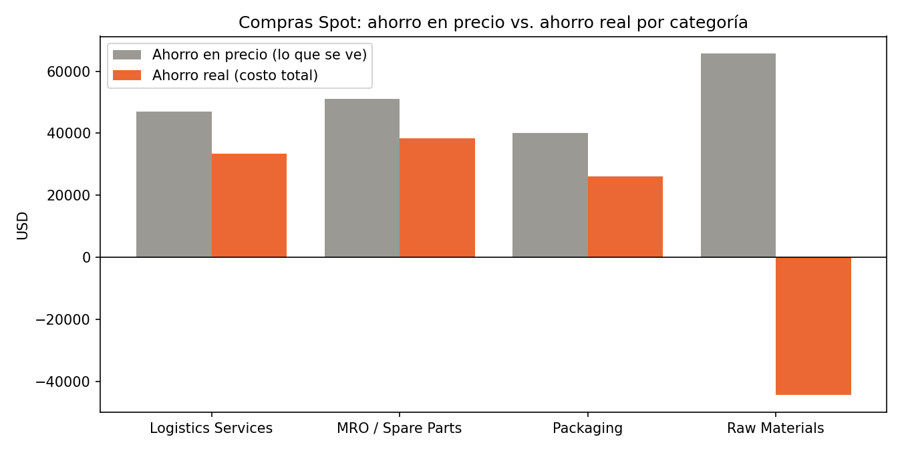

# Caso de estudio: compras Spot vs. Contrato

**¿El "buen precio" de una compra Spot fue realmente un buen negocio?**

El enunciado original está en [ENUNCIADO.md](ENUNCIADO.md) y el contexto de negocio en [Case_Study_CONTEXT.pdf](Case_Study_CONTEXT.pdf).

## Estructura del repositorio

| Archivo / carpeta | Qué contiene |
|---|---|
| `*_SAMPLE.csv`, `*_SAMPLE.xlsx` | Datos originales (sin modificar) |
| [01_limpieza_datos.ipynb](01_limpieza_datos.ipynb) | Revisión de calidad, correcciones y exportación de los datos limpios |
| [datos_limpios/](datos_limpios/) | `compras_limpias.xlsx` (tabla lista para el análisis), `capacidad_centros.xlsx`, `log_calidad_datos.xlsx` |
| [02_analisis.ipynb](02_analisis.ipynb) | Análisis a partir de los datos limpios |
| [graficos/](graficos/) | Gráficos generados por el análisis |
| [USO_IA.md](USO_IA.md) | Nota sobre el uso de IA |

**Cómo ejecutarlo:** `pip install -r requirements.txt`, luego correr `01_limpieza_datos.ipynb` y después `02_analisis.ipynb`.

---

## TASK 1: Interpretación de negocio

### Método

Para cada línea de compra calculé el **costo total por unidad**:

```
costo total = precio + transporte / cantidad + costo almacenamiento diario × días en bodega
            + castigo por vencimiento (50% del precio, solo si los días en bodega superan la vida útil)
```

Cada compra Spot se compara con el **mismo material comprado por contrato**: la mediana del costo total de sus compras por contrato.

- **Ahorro en precio:** lo que ve el comprador (solo el precio).
- **Ahorro real:** la diferencia en costo total.

**Ejemplo: PO10041-S, Wheat Bran, 1.875 unidades.**
- Precio Spot 4,10 contra 5,04 por contrato: **19% de descuento**.
- Transporte: 601,32 / 1.875 = 0,32 por unidad.
- Almacenamiento: 0,0579 × 137 días = 7,93 por unidad.
- Vida útil de 44 días, así que el lote venció. Castigo: 50% × 4,10 = 2,05 por unidad.
- Costo total: **14,40 contra 5,71** por contrato. Pérdida real de **-16.305 USD**.

### Resultados (48 compras Spot con datos completos y contrato para comparar)

| Categoría | Compras Spot | Descuento en precio (mediana) | Ahorro real (mediana) | Ahorro en precio (USD) | Ahorro real (USD) | Buenos negocios | Lotes vencidos |
|---|---|---|---|---|---|---|---|
| Raw Materials | 17 | 18% | **-41%** | +65.695 | **-158.359** | 3 / 17 | 14 |
| Packaging | 10 | 13% | +7% | +40.176 | +26.072 | 8 / 10 | 0 |
| MRO / Spare Parts | 10 | 18% | +13% | +51.148 | +38.468 | 10 / 10 | 0 |
| Logistics Services | 11 | 12% | +8% | +47.008 | +33.445 | 9 / 11 | - |
| **Total** | 48 | 16% | +6% | **+204.027** | **-60.374** | 30 / 48 | 14 |

El precio bajo sí era real. Comparados con el benchmark, los precios Spot estaban entre 13% y 16% por debajo de la referencia, y los de contrato muy cerca de ella. El problema aparece después de la compra.



### Afirmación 1: en materias primas perecederas, Spot destruye valor por el tiempo en bodega, no por el precio

- **Evidencia (calculada):** un ahorro aparente de +65.700 USD termina en -158.400 USD. 14 de 17 lotes superaron su vida útil: estuvieron ~116 días en bodega, cuando la vida útil es de ~65 y las compras por contrato se quedan ~24. El descuento alcanzaría para ~96 días de almacenamiento, pero el producto se vence antes. Las 3 compras rentables son justamente las 3 que se usaron antes de vencerse.
- **Supuestos:** todo el lote se queda `DaysInStorage` días. Un lote vencido pierde el 50% de su precio. Las tarifas de almacenamiento son correctas.
- **Qué limita la confianza:** la conclusión **no depende** del castigo por vencimiento: con 0% sigue en -44.400 USD. **Sí depende** de las tarifas de almacenamiento, que parecen altas (Wheat Bran: ~1,2% de su valor por día). Solo con la mitad de la tarifa y sin castigo, el resultado pasa a +6.400 USD. Además, la muestra es pequeña (17 compras) y no hay fechas reales de recepción y consumo.

### Afirmación 2: en materiales duraderos (empaque y repuestos), Spot sí conviene si el descuento cubre el almacenamiento

- **Evidencia:** 18 de 20 compras con ahorro real (+64.500 USD de +91.300 USD en precio). Se conserva ~70% del descuento. El descuento aguanta ~400 días en bodega, y estos lotes estuvieron ~110-145 días con vidas útiles de años. Las 2 pérdidas (Bag Closure Thread) son de un material de ~3 USD con descuento casi nulo, que no alcanzó a cubrir 160 días de almacenamiento.
- **Regla práctica para los negociadores:** comprar Spot solo si el descuento por unidad es mayor que el transporte extra más el costo de almacenamiento por los días que tardará en consumirse, **y** si esos días están bastante por debajo de la vida útil.
- **Qué limita la confianza:** muestra pequeña. Además, los servicios logísticos aparecen con días en bodega y marcados como Spot, lo cual es raro; por eso a esos días les puse 0.

### Lo que el caso no da y cómo lo manejé

- **Costo de vencimiento:** supuse una pérdida del 50% del precio si el lote supera su vida útil. Probé 0%, 25%, 50% y 100%: cambia el tamaño de la pérdida en materias primas (-44.000 a -272.000 USD), pero nunca la vuelve positiva.
- **Capacidad de bodega:** supuse que es **compartida** por todos los lotes que están al mismo tiempo en un centro. Con unidades-día (cantidad × días), las compras Spot ocupan entre el 65% y el 82% del espacio de cada centro. Solo con la muestra, la Port Bonded Warehouse ya usa en promedio al menos el 62% de su capacidad. No le asigné un costo en dinero porque los datos no lo permiten, pero es un costo oculto de Spot.

### Problemas de calidad de datos (detalle en `datos_limpios/log_calidad_datos.xlsx`)

| Problema | Filas | Decisión |
|---|---|---|
| Códigos `MAT-01004` / `MAT-01015` con un cero de más | 16 | Corregidos |
| Orden más grande que **toda** la bodega del centro (PO10156-N, PO10139-S, PO10072-P) | 3 | Excluidas. Si se incluyen, materias primas pierde ~1,1 millones USD más |
| Centro distinto al sufijo del POSampleID | 2 | Se deja `Center`, marcado |
| Fecha de diciembre de 2023 (fuera de alcance) | 1 | Excluida |
| Sin transporte / sin días en bodega | 4 / 5 | Excluidas del cálculo, sin imputar |
| Servicios con días en bodega / materiales UNKNOWN sin costo de almacenamiento | 22 / 18 | Servicios: días = 0. UNKNOWN: excluidos |
| Bonded Storage Fee en plantas que no son aduaneras | 8 | Se deja, es una pregunta para el negocio |
| Material-centro sin benchmark, benchmark solo hasta junio | 28 | Benchmark solo como comprobación |
| Números de lote repetidos en materiales distintos | 6 | No se usa como llave |

**Preguntas para un analista de compras:** ¿`DaysInStorage` es medido o estimado, y aplica a todo el lote? ¿En qué unidad está el costo de almacenamiento? ¿Qué pasa con el material vencido (se bota, se usa igual, se vende más barato)? ¿Quién decide si una compra es Spot, y por qué aplica a servicios? ¿La capacidad está en la misma unidad que la cantidad?

---

## TASK 2: Modelo de datos

**Idea principal:** separar los **hechos** (las compras) de los **catálogos** (materiales, centros, proveedores). Lo que puede crecer, como nuevos tipos de costo o nuevos precios de referencia, se guarda **en filas y no en columnas**. Así, agregar un costo nuevo es agregar filas, sin cambiar la estructura.

```
Catálogos                         Hechos
---------                         ------
materiales  ───┐                  compras            (1 fila por línea de orden)
centros     ───┼──── llaves ────  costos_compra      (1 fila por compra y tipo de costo)
proveedores ───┤                  precios_referencia (1 fila por material, centro, tipo y fecha)
negociadores───┘                  tarifas_almacenamiento, capacidad_centros (con fecha de vigencia)
                                  clasificacion_modo_compra (Spot/Contract, con versión de la regla)
```

| Tabla | Columnas principales | Por qué |
|---|---|---|
| `compras` | po_line_id, material, centro, proveedor, negociador, unidad_negocio, fecha_orden, **fecha_recepcion, fecha_consumo**, cantidad, precio | Con fechas en vez de `DaysInStorage` se calculan los días en bodega y la ocupación diaria |
| `costos_compra` | po_line_id, tipo_costo (transporte, almacenamiento, vencimiento, aranceles…), monto, origen (real/estimado) | Un costo nuevo es un tipo nuevo, no una columna nueva |
| `precios_referencia` | material, centro, tipo_precio (anterior, planeado, mercado…), precio, fecha | Reemplaza las columnas `PlannedPrice2`, `PlannedPrice3` |
| `materiales` | código, nombre, categoría, grupo, vida_util, es_perecedero, vigente_desde/hasta | Nuevas categorías = nuevas filas; se guarda el historial si cambian |
| `centros` y `capacidad_centros` | centro, nombre, tipo (aduanero o no), capacidad, tipo de almacenamiento, fecha | Nuevos centros = nuevas filas |
| `clasificacion_modo_compra` | po_line_id, modo, versión de la regla, quién lo clasificó | Spot/Contract es una etiqueta del negocio, no un campo de SAP. Otras áreas pueden clasificar distinto |
| `supuestos` | nombre, valor, responsable, fecha (ej. castigo_vencimiento = 0,5) | Los supuestos quedan visibles y versionados |
| `log_calidad` | tabla, registro, problema, decisión, fecha | Como el log de este análisis, pero automático |

Para **unir con otras unidades de negocio**, todas las tablas comparten los mismos catálogos y llevan una columna `unidad_negocio`.

**Preguntas que influyen en el modelo:** ¿El costo de almacenamiento y la vida útil cambian por centro? Si cambian, van en una tabla por material y centro. ¿El transporte se factura por envío y se reparte entre líneas? ¿Los números de lote se repiten por planta? (en la muestra se repiten). ¿Qué son exactamente `PlannedPrice2` y `PlannedPrice3`? ¿La capacidad se divide por tipo de bodega (seca, fría, aduanera)?

**Herramientas:** Python (pandas) en notebooks para explorar y limpiar, como en este caso. SQL en el lakehouse para las tablas del modelo, con validaciones automáticas (que el código de material exista, que no haya nulos, que la cantidad no supere la capacidad, que las fechas estén en rango). Excel o Power BI para que los compradores consulten el resultado. Git para versionar.
